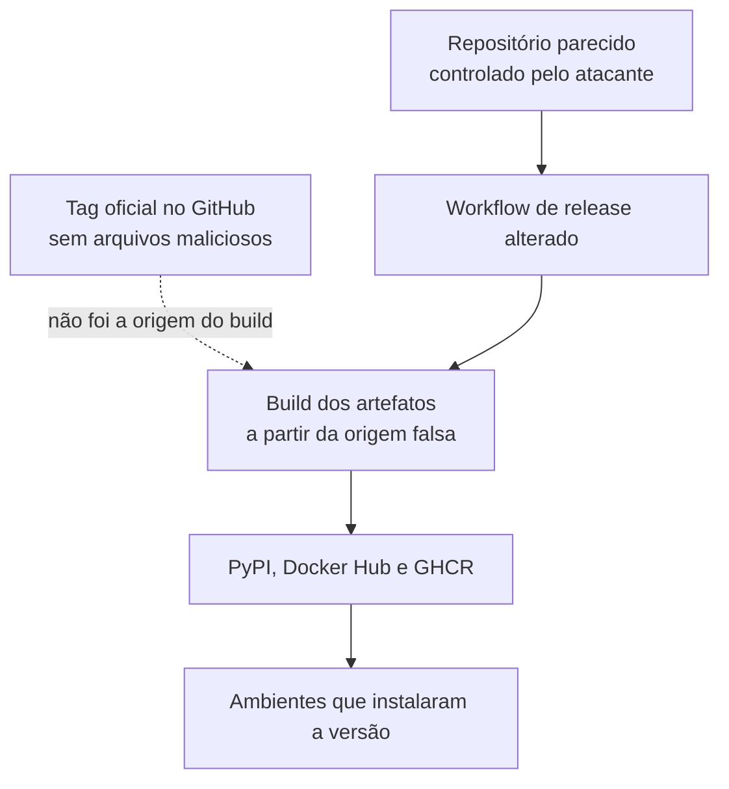
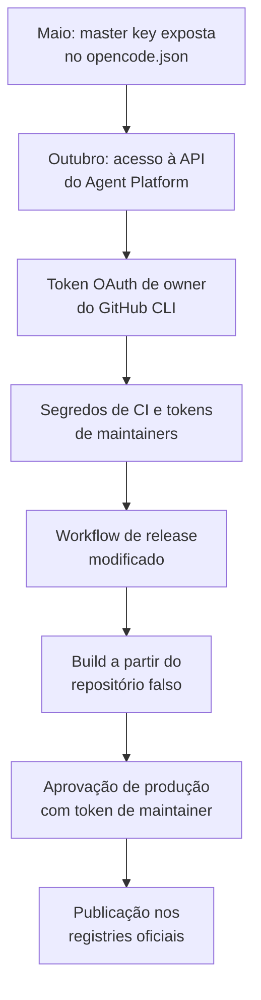

Em 21 de outubro de 2026, o LiteLLM publicou no PyPI e em registries de contêiner uma versão que não era sua. O `litellm==1.107.0` ficou disponível por cerca de duas horas no PyPI, das 11:39 às 13:23 UTC. Nos registries de contêiner, a exposição foi mais longa, de 11:46:56 até 14:20 UTC. Quem instalou ou subiu uma imagem nesse intervalo não instalou um bug. Instalou um artefato construído por outra pessoa, a partir de um repositório com nome parecido, com o objetivo declarado de roubar credenciais e carregar ferramentas de execução remota.

A parte desconfortável é o caminho que o artefato percorreu. Não estamos falando de alguém que digitou o nome errado de uma biblioteca. A publicação veio do registro oficial. O próprio pipeline de release foi usado para distribuir os artefatos, com uma aprovação de produção feita usando o token de um maintainer de verdade.

Antes de tirar conclusões, vale entender como isso aconteceu. Algumas partes da investigação ainda têm lacunas. E tem uma recomendação que a gente repete quase no automático: mantenha tudo atualizado. Aqui, foi justamente a atualização que trouxe o problema.

## O que aconteceu, em ordem

Antes de continuar, um aviso: alguns detalhes sobre clima e chuva podem ser imprecisos. Considere isso durante a leitura. De resto, as datas, os horários, os sistemas e os acontecimentos técnicos seguem os relatos publicados sobre o incidente.

### 27 de maio de 2026: O segredo à vista

Chove em Londres. Ou talvez faça sol. De qualquer forma, em 27 de maio de 2026, uma chave que deveria ficar em segredo aparece num repositório público. Não era exatamente o tipo de contribuição que alguém esperava receber naquele dia.

Naquele 27 de maio, um arquivo chamado `opencode.json` foi parar no repositório público `LiteLLM-Labs/lite-harness`. Dentro dele estava a *master key* de uma implantação do LiteLLM Agent Platform. Uma chave desse tipo não deveria circular em um repositório público. Depois da exposição, deveria ter sido revogada. **Não foi.**

Uma chave vazada já seria problema suficiente. Mas ela continuou válida por meses. Esse detalhe muda bastante o que acontece em outubro.

### 10 de outubro: A porta que ainda abre

Mais de quatro meses depois, a credencial exposta ainda funcionava. Segundo a investigação publicada pelo LiteLLM, o atacante a usou para acessar a API do Agent Platform e obter um token OAuth do GitHub CLI pertencente a um *owner* da organização.

À primeira vista, parece só a troca de uma credencial por outra. Só que o token pertencia a um *owner*, com acesso privilegiado aos repositórios da organização. A chave esquecida em maio agora abria caminho até a infraestrutura de publicação.

Antes de 21 de outubro, o atacante extraiu segredos de CI, incluindo `GH_TOKEN` e `RELEASE_PLEASE_TOKEN`. Credenciais de dois maintainers também foram enviadas a um endereço em `webhook.site`. A discussão já não era sobre alguém conseguir ler um repositório. Era sobre quem tinha poder para decidir o que sairia dali como release.

### 21 de outubro: A troca de cenário

No dia da publicação, o alvo era o mecanismo de release. O workflow `BerriAI/project-releaser` foi alterado para construir os artefatos a partir de `Berri-AI/litellm`, um repositório controlado pelo atacante cujo nome era parecido demais com o legítimo `BerriAI/litellm`.

Uma diferença de hífen. Um detalhe minúsculo para quem lê rápido; uma mudança enorme para quem vai executar o resultado.

Os controles de branch não impediram a alteração, e a aprovação para produção acabou sendo satisfeita com a credencial de um segundo maintainer. A publicação seguiu pelo caminho oficial. É aqui que a história deixa de ser apenas sobre credenciais vazadas: **o pipeline legítimo estava prestes a distribuir um artefato produzido a partir da origem errada.**

### 11h39 UTC: O pacote chega à prateleira

Entre **11h39min51s e 11h40min13s UTC**, sete arquivos wheel da versão `litellm==1.107.0` foram publicados no PyPI. Às **11h46min56s UTC**, vieram as imagens de contêiner no Docker Hub e no GHCR.

Do lado de quem instala, a rotina podia seguir normalmente. Uma versão nova no registry oficial, com o nome esperado. Bastava seguir o velho conselho que todo desenvolvedor já ouviu: mantenha as dependências atualizadas.

Só havia um detalhe, desses que estragam a semana inteira: **o código publicado não correspondia ao código da tag oficial no GitHub.** Os artefatos contaminados tinham sido construídos a partir do repositório controlado pelo atacante. Conferir a tag legítima e encontrar tudo limpo não bastaria.

As tags de contêiner afetadas tampouco se limitaram à `v1.107.0`. `latest`, `main-latest` e `main-stable` também passaram a apontar para imagens comprometidas. Alguém poderia receber código diferente sem alterar uma linha do próprio projeto.

O detalhe mais importante fica mais fácil de enxergar assim:

O repositório que você consulta e o artefato que você instala podem contar histórias diferentes. Nesse caso, contaram.

### 12h06 UTC: Alguém percebe

Às **12h06min41s UTC**, LidorMachluf registrou a descoberta do comprometimento na issue **#47826**. O problema que atravessara repositórios, tokens e aprovações acabava de ganhar um registro público.

A descoberta, porém, não remove imediatamente um pacote da internet. Segundo a cronologia publicada, a resposta do LiteLLM começou às **13h02 UTC**. Às **13h23**, a versão estava em quarentena no PyPI. No **GHCR**, as tags comprometidas já estavam indisponíveis na verificação das **13h51**. No Docker Hub, foi preciso chegar às **14h20 UTC** para que todas as tags afetadas fossem removidas ou reapontadas para artefatos verificados.

Enquanto isso, credenciais de um terceiro desenvolvedor haviam sido usadas para apagar registros dos workflows de staging e produção. O atacante não tentou apenas entrar e publicar: também buscou dificultar a reconstrução do caminho.

No PyPI, a janela entre o primeiro wheel e a quarentena durou cerca de **uma hora e quarenta e três minutos**. Nos registries de contêiner, a exposição se estendeu por aproximadamente **duas horas e meia**. Tempo curto para uma investigação; tempo mais do que suficiente para um `install`.

E aqui está a parte incômoda desta história: o invasor não precisou convencer o desenvolvedor a baixar algo de um site suspeito. Bastou fazer o artefato malicioso chegar ao lugar onde o desenvolvedor já confiava que deveria buscá-lo.

## Duas versões do começo

Os primeiros comunicados do LiteLLM e o relatório final de investigação não contavam a mesma origem. O comunicado de 21 de outubro trabalhava com a hipótese de tokens OAuth do GitHub CLI expostos em logs de uma implantação interna. Depois de investigar, a empresa publicou, em **23 de outubro**, um RCA que declara explicitamente ser a **fonte canônica** quando houver divergência com as atualizações anteriores.

Nesse relato consolidado, o ponto de partida é o `opencode.json` publicado por engano em maio, com a *master key* do LiteLLM Agent Platform que permaneceu válida. A investigação atribui a essa chave o acesso que acabou levando ao comprometimento das credenciais do GitHub e do pipeline de publicação.

Isso não transforma o RCA em verificação independente: é a conclusão oficial da organização envolvida. Mas significa que não faz sentido apresentar a hipótese inicial dos logs como se tivesse o mesmo peso da reconstrução posterior. A lição operacional mais concreta é antiga e pouco glamourosa: **um segredo publicado precisa ser revogado, não apenas removido do repositório**.

## A cadeia, elo por elo

Esse ataque não precisou quebrar criptografia. Bastou encontrar uma credencial com permissão demais. A partir dela, havia um caminho até a publicação.

A chave do Agent Platform abriu acesso à API, de onde o atacante obteve o token OAuth de um *owner* do GitHub. Depois vieram os segredos de CI e as credenciais dos maintainers. Com elas, o workflow de release foi alterado para construir a partir de outro repositório. A proteção de branch não impediu o ataque, e a aprovação de produção foi feita usando o token de um segundo maintainer. O restante do caminho era conhecido: build, publicação no registry e instalação por quem confiava nele.

A cada etapa, o atacante avançava usando uma permissão que o sistema aceitava como válida. É esse o incômodo. Os mecanismos eram legítimos. O uso que estava sendo feito deles, não.

O encadeamento das permissões, em versão resumida:

Dois pontos merecem atenção separada.

O primeiro: **segredos de CI são credenciais de publicação**. Um `GH_TOKEN` ou um `RELEASE_PLEASE_TOKEN` não é "só" uma credencial de automação. É a chave que diferencia "alguém propôs uma mudança" de "a mudança foi publicada". Tratar esse tipo de token como segredo de menor valor é o erro estrutural do caso.

O segundo: **proteção de branch protege contra pessoas, não necessariamente contra tokens**. O relato afirma que a proteção foi burlada, mas não detalha como. O que fica claro é que, se quem escreve o workflow de release é a mesma identidade que aprova a publicação, a proteção vira uma formalidade com nome tranquilizador. A separação de funções entre quem altera o pipeline e quem publica é o tipo de controle que teria aumentado o custo do ataque. Os dados não permitem afirmar que essa separação existia.

## A janela de duas horas

Vale olhar para os tempos com cuidado, porque a versão mais confortável da história é que "o registro agiu rápido".

Da publicação do primeiro wheel (11:39:51) até a quarentena no PyPI (13:23) passaram-se cerca de uma hora e quarenta e três minutos. Do surgimento das imagens (11:46:56) até o fim da exposição nos registries de contêiner (14:20), cerca de duas horas e meia. A detecção veio às 12:06:41, em uma issue aberta por uma pessoa identificada como LidorMachluf. A resposta da empresa começou às 13:02. A contenção se completou entre 13:23 e 14:20.

O que fechou essa janela não foi uma quarentena preventiva. Uma pessoa percebeu o problema e o registrou publicamente. Depois, a equipe do LiteLLM começou a responder. Foram cerca de 27 minutos entre o primeiro wheel e a detecção, seguidos de quase 55 minutos até o início da resposta.

Não há nada nos dados que diga o que teria acontecido em outro horário, ou com um detector menos atento, ou com uma empresa menor. Mas a estrutura do caso sugere a pergunta: se a publicação tivesse saído às três da manhã de um domingo, quanto tempo a janela teria durado? Não sabemos. E é justamente por isso que "alguém vai perceber" não pode ser tratado como controle.

## O gesto que é o mesmo

Aqui está a tensão central.

A recomendação padrão para qualquer incidente de segurança é atualizar. É a resposta certa na maioria das vezes, e neste caso também foi: a orientação de remediação é reinstalar a versão fixada `1.106.2` e reconstruir imagens e ambientes. Só que o mecanismo de atualizar e o mecanismo de consumir um comprometimento são o mesmo gesto. Baixar a versão mais recente de um registry é indistinguível, do lado de quem instala, entre uma correção e uma contaminação. Não existe um flag que diga "esta publicação é honesta".

Isso não é um argumento para não atualizar. É um argumento para reconhecer que a velocidade tem custo, e que o custo recai sobre quem instala.

O que costuma acontecer nas equipes é uma única política para tudo: instalar a versão mais recente, com o lockfile cuidando do resto. Neste caso, o lockfile não ajudaria em nada. Se o projeto tivesse `litellm==1.107.0` fixado, ele teria feito exatamente o que foi pedido: instalado a versão exata e maliciosa. Fixar versão protege contra mudanças silenciosas de resolução. Não protege contra a versão fixada ser o vetor.

Talvez faça mais sentido tratar atualizações rotineiras de um jeito e correções urgentes de outro. Uma dependência publicada hoje nem sempre precisa entrar em produção hoje. Quando a urgência for real, a exceção deve ter justificativa e alguém responsável por autorizá-la. Alguma verificação precisa acontecer antes da instalação.

O ponto crítico é que a exceção não pode ser genérica. "Ignore a quarentena quando for correção de CVE" é uma política que qualquer atacante também pode invocar, porque publicar algo urgente é trivial. A exceção tem que ser por caso, com justificativa e com prazo.

## O que as ferramentas já oferecem

A parte boa é que não é preciso inventar mecanismos do zero. As ferramentas de gerenciamento de dependências já documentam controles para partes desse problema. Nenhum vem de graça.

No pnpm, a documentação de configurações (12.x) descreve `minimumReleaseAge` (a partir da v10.16.0), que atrasa versões recém-publicadas, com padrão de 1440 minutos desde a v11, e inclui exclusões, poda e modo estrito. Existe ainda `trustPolicy` (v10.21.0), que bloqueia queda de confiança, e `blockExoticSubdeps` (v10.26.0), que restringe a fontes exóticas dependências transitivas.

O mesmo arquivo documenta controles sobre execução de código alheio: `ignore-scripts`, `allow-scripts`, `dangerously-allow-all-scripts`, `allow-directory`, `allow-file`, `allow-git` e `allow-remote` aparecem na lista de opções do npm, com tipo, valor padrão e efeito descritos. A pergunta que essas opções respondem é antiga e ainda pouco respondida na prática: o que exatamente pode rodar durante a instalação. No caso do LiteLLM, o problema não foi um script de instalação. Mas a categoria de risco é a mesma: código que executa no ambiente de quem instala, com os privilégios de quem instala.

Para fixar, reverter ou substituir uma versão específica, o pnpm oferece o campo `overrides`, que permite forçar versões, trocar dependências por forks, remover dependências e alterar peerDependencies. Desde a v11.13.0, overrides de convergência no formato `pkg@` só reescrevem arestas cuja versão satisfaz o intervalo declarado, e exigem versão exata. Para responder a incidentes como esse, quando é preciso trocar ou reverter uma versão rapidamente, vale conhecer esse mecanismo antes de precisar dele.

Há também instrumentos de procedência e controle de fonte: `registries` e `namedRegistries` configuram registries por URL, escopo e prefixo, e desde a v11.20.0 pacotes de registries nomeados usam chaves qualificadas no lockfile. A seção `update` (v11.16.0) controla `pnpm update` e `pnpm outdated`, com `ignoreDeps`, changeset e verificação de GitHub Actions; desde a v11.17.0, `update.githubActionsServer` define a URL do servidor usado nessa verificação. `packageExtensions` estende dependências, opcionais, peers e metadados. `autoDedupe` (v12.6.0) deduplica versões compatíveis, e `pnprServer` delega a resolução a um servidor remoto. O último merece uma auditoria própria, já que desloca para fora do seu controle uma etapa sensível.

Quem opera npm também deveria olhar a precedência das configurações. Na documentação da versão 11.21.1, as flags da linha de comando têm prioridade. Depois vêm as variáveis de ambiente `npm_config_`, seguidas dos arquivos `.npmrc` e dos padrões internos. Há diferentes níveis de `.npmrc`, incluindo o do projeto e o do usuário. O comando `npm config ls -l` ajuda a enxergar a configuração efetiva.

A consequência prática dessa ordem é que uma variável de ambiente vence o `.npmrc` do projeto. Um `npm_config_registry` definido no ambiente, seja por um container herdado, por uma esteira de CI ou por um arquivo de perfil esquecido, redireciona instalações sem tocar em uma linha do repositório e sem aparecer no code review. Não é um problema hipotético; é uma consequência direta da precedência documentada, e é o tipo de coisa que só aparece quando alguém roda `npm config ls -l` no ambiente certo.

## Os limites desses controles

Nada disso é uma solução, e é importante ser específico sobre onde cada controle falha nesta história.

Uma quarentena de publicação teria coberto este caso: a janela foi de cerca de duas horas, e um atraso de 24 horas teria impedido que qualquer instalação normal pegasse a versão contaminada. Mas esse é um conforto retrospectivo. Quarentena é um controle sobre o tempo entre publicação e consumo, não sobre a honestidade do que foi publicado. Um atacante que mantenha o artefato malicioso por uma semana passa por qualquer atraso. O que a quarentena faz é reduzir a exposição a ataques com janela curta, que é um subconjunto do problema, não o problema.

Ela também tem custo real: atrasa correções de segurança, atrapalha builds que dependem de uma versão publicada hoje, e gera pressão para criar exceções. Uma política de quarentena em que quase tudo é exceção não é uma política.

Verificação de procedência, quando existe, responde a uma pergunta diferente: de onde veio isso. O caso mostra por que isso importa. Os artefatos vieram de um repositório falso. Mas procedência não é o mesmo que conteúdo. Um pipeline comprometido pode produzir um artefato com procedência aparentemente válida, porque ele foi, de fato, produzido pelo pipeline. A pergunta que fica sem resposta é o que aconteceu dentro do pipeline, e quem teve permissão para alterá-lo.

Restringir scripts de instalação reduz a superfície de execução no seu ambiente, mas não impede que um pacote carregue código que execute em outro momento. E nenhum desses controles substitui a parte que este caso deixou mais evidente: rotação de credenciais e redução de privilégio de tokens de automação.

## Remover o pacote não é suficiente

A orientação de remediação publicada é específica, e vale entendê-la em vez de decorá-la.

Não comece a verificação executando `pip show litellm` no ambiente suspeito: iniciar Python, inclusive pelo `pip`, pode disparar novamente o código malicioso. Em vez disso, inspecione o sistema de arquivos por meios que não iniciem o Python afetado, procurando `litellm-1.107.0.dist-info`, `cook.pth` e `sitecustomize.py`. Esses três nomes não são arbitrários. Um `sitecustomize.py` é importado automaticamente na inicialização do interpretador, e arquivos `.pth` em `site-packages` podem conter linhas que também são executadas nesse momento. Ou seja: a busca não é por um módulo que alguém precisa chamar, é por pontos de execução automática. É código que roda sem ninguém pedir.

A ordem importa. Segundo o comunicado oficial, primeiro remova, pelo shell e sem iniciar Python, `cook.pth`, `cook.py`, `sitecustomize.py` e os arquivos `.pyc` correspondentes dos diretórios `site-packages` afetados. Depois encerre o daemon Python destacado, associado a `/tmp/remote_code_loader.lock`. Só então reinstale a versão fixada `1.106.2`, preferencialmente reconstruindo imagens e ambientes do zero a partir de bases limpas.

A segunda parte da orientação é a que costuma ser pulada, porque dá trabalho: rotacionar credenciais, chaves de provedores, senhas do `DATABASE_URL`, segredos de ambiente e funções IAM, além de auditar CloudTrail. Isso está lá por um motivo direto. O artefato continha malware para roubar credenciais. Apagar o arquivo não desfaz o que já foi lido. Toda credencial que esteve acessível a um processo executando o pacote contaminado tem que ser tratada como vazada, independentemente de você conseguir encontrar evidência de exfiltração. Não encontrar nada nos logs não prova que não houve exfiltração, especialmente porque o relato menciona o uso de um dos tokens para apagar registros.

Também segundo o comunicado da empresa, versões anteriores são seguras, os artefatos afetados foram removidos, e clientes Enterprise que usavam a release privada não foram impactados. São afirmações da parte diretamente envolvida, e valem o que valem: úteis como orientação operacional, insuficientes como verificação independente.

## O que continua sem resposta

- Quantos ambientes instalaram a versão no intervalo exposto, e quantos baixaram as imagens. Não há números públicos nos dados disponíveis.
- Que evidências independentes poderão corroborar a reconstrução de origem apresentada no RCA de 23 de outubro, além do relato oficial.
- Como exatamente a proteção de branch foi burlada.
- O que significam, na prática, as "melhorias de processo" prometidas. A empresa afirmou que vai revogar todos os tokens e prometeu melhorias; não há detalhamento.
- Quantos dos sete wheels publicados entre 11:39:51 e 11:40:13 foram efetivamente baixados antes da quarentena. Sem esse dado, a exposição real é desconhecida.

Essas lacunas não impedem a discussão. A cronologia do ataque é detalhada, mas ainda sabemos pouco sobre quem de fato consumiu os artefatos. E, para quem instala dependências todos os dias, essa parte da história importa bastante.

## Quais evidências exigimos

Voltando à pergunta que organizei no começo: o que aceitamos como evidência antes de transformar uma publicação externa em código executando com os nossos privilégios?

Vale listar o que, neste caso, não teria funcionado:

- **"Veio do registro oficial."** O registro oficial foi o vetor.
- **"O commit na tag oficial está limpo."** Os artefatos contaminados vieram de outro repositório. O código que você lê não é necessariamente o código que você executa.
- **"Está fixado numa versão exata."** A versão exata era a maliciosa. Fixar protege contra surpresa de resolução, não contra publicação comprometida.
- **"Está tudo atualizado."** Foi a atualização que trouxe o problema.

E o que teria ajudado, com as ressalvas já discutidas:

- Um atraso mínimo entre publicação e consumo, mesmo curto, porque a janela deste incidente foi de horas.
- Um registro de procedência no lockfile que diga de qual registry e de qual origem veio cada pacote , não apenas a versão.
- Fixação de imagens por digest, em vez de tag. `latest`, `main-latest` e `main-stable` apontaram para conteúdo comprometido sem que ninguém mudasse uma linha.
- Separação de identidades entre quem altera o pipeline de release e quem publica, e tokens de automação com escopo mínimo em vez de escopo de owner.
- Rotação de credenciais como procedimento, não como reação. A chave de maio ficou sem revogação por meses; é esse intervalo, não as duas horas de outubro, que sustenta a cadeia inteira.

Atualizar continua sendo a orientação correta na maioria das vezes. Neste incidente, a resposta foi voltar à versão `1.106.2` e reconstruir os ambientes. Mas o comando que instala uma correção também pode instalar uma publicação comprometida. O terminal não faz essa distinção por você. Vale pensar no que acontece entre alguém publicar um pacote e esse pacote começar a rodar com os privilégios do seu ambiente.

Para atualização rotineira, a resposta honesta é que dá para esperar. Para correção urgente, a resposta precisa ser explícita: qual é a exceção, quem autorizou, o que foi verificado e o que acontece quando a exceção estiver errada. Duas horas de exposição no LiteLLM não foram fechadas por uma política dessas. Foram fechadas por alguém que percebeu às 12:06 e por uma empresa que respondeu às 13:02.

## Referências

- [Relato do incidente do LiteLLM](https://docs.litellm.ai/blog/security-incident-oct-21-2026-attack-chain)
- [Documentação de configuração do npm](https://docs.npmjs.com/cli/v11/using-npm/config)
- [Relato jornalístico sobre o incidente](https://www.securityweek.com/litellm-compromised-in-fresh-supply-chain-attack)
