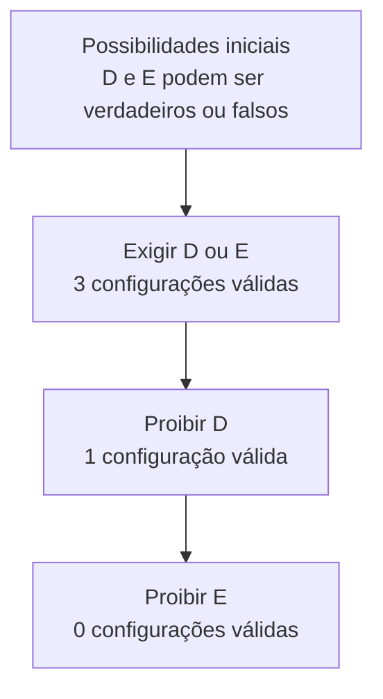
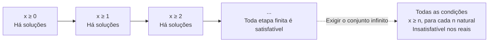
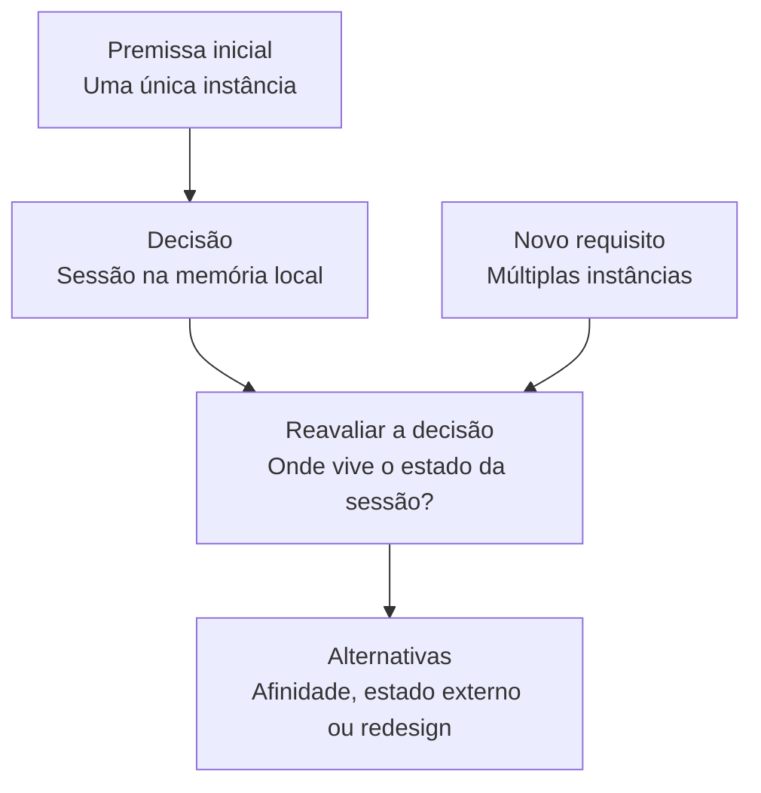

Imagina que eu te peça uma coisa relativamente simples: olhe para a direita ou para a esquerda. Não precisa fazer os dois, basta escolher um lado. Até aqui, nenhum grande desafio cognitivo, espero. Agora eu acrescento uma regra: você não pode olhar para a direita. Tudo bem, olhe para a esquerda. Só que eu resolvi complicar um pouco a brincadeira. Também não pode olhar para a esquerda.

A pergunta que me interessa não é exatamente *por que* você não consegue cumprir as três regras. Isso parece evidente. Quero entender **em que momento um conjunto de restrições deixa de admitir uma solução**, e o quanto essa ideia ajuda a pensar nas decisões que tomamos ao desenvolver software. Talvez exista uma forma mais interessante de olhar para a arquitetura de um sistema do que apenas enumerar as funcionalidades que ele oferece. E se começássemos pelas possibilidades que nossas próprias decisões eliminam?

## Quando uma regra deixa de ser só uma regra

Vamos dar nomes às duas possibilidades:

- `D`: olhar para a direita.
- `E`: olhar para a esquerda.

A primeira condição exige olhar para pelo menos um dos lados. Escrevemos `D ∨ E`. O símbolo `∨` significa **OU** lógico, inclusive permitindo os dois lados ao mesmo tempo. A segunda proíbe olhar para a direita: `¬D`. A terceira proíbe olhar para a esquerda: `¬E`. Juntando tudo:

```text
(D ∨ E) ∧ ¬D ∧ ¬E
```

O `∧` é o **E** lógico. Queremos que todas as condições sejam verdadeiras simultaneamente. E não existe atribuição de valores para `D` e `E` capaz de satisfazer essa expressão. Antes de acrescentar a última regra, ainda existia uma saída: `D = falso` e `E = verdadeiro`. Depois dela, nenhuma.



Esse é um exemplo de **insatisfatibilidade**. Na lógica, dizemos que uma fórmula é satisfatível quando existe pelo menos uma atribuição de valores que a torna verdadeira. Se nenhuma atribuição funciona, ela é insatisfatível. O estudo desses problemas aparece em **SAT** (*Boolean Satisfiability Problem*) e também em **CSP** (*Constraint Satisfaction Problems*), uma família mais ampla de problemas em que variáveis precisam assumir valores respeitando um conjunto de condições.

E vale uma distinção antes de continuar: estou falando de satisfação de restrições em lógica e computação, não da *Teoria das Restrições* de gestão de operações, associada à identificação de gargalos. Os nomes se parecem, mas as perguntas aqui são outras.

## Um conjunto não fica maior porque você repetiu a mesma coisa

Se temos um conjunto `R = {A, B}` e acrescentamos `A` novamente, continuamos com `{A, B}`. Repetir um elemento não cria um elemento novo. Só que, quando tratamos restrições como expressões lógicas, existe uma sutileza: duas frases diferentes podem impor exatamente a mesma condição. "É proibido olhar para a direita" e "é obrigatório não olhar para a direita" são formulações distintas, mas logicamente equivalentes. Tem também um caso mais curioso:

> É proibido olhar para a direita.

E, depois:

> É proibido olhar para a direita quando estiver chovendo.

A segunda condição, considerada isoladamente, não é equivalente à primeira. Mas, se já é proibido olhar para a direita em qualquer situação, a chuva não muda nada. A nova regra não elimina uma única possibilidade adicional. Isso importa porque **contar documentos, frases ou requisitos não é o mesmo que contar restrições que efetivamente reduzem o espaço de soluções**. Uma especificação pode ter 500 regras e continuar permitindo as mesmas configurações que outra com 20. A quantidade, sozinha, diz muito pouco sobre o que o sistema consegue ou não fazer.

Para deixar mais preciso, chamemos de `Ω` (*ômega*) o universo de configurações possíveis e de `S(R)` o subconjunto das configurações que respeitam todas as restrições de `R`. Ao acrescentar uma condição `r`, temos:

`S(R ∪ {r}) ⊆ S(R)`

Ou seja, **acrescentar uma restrição não aumenta o conjunto de soluções válidas**. Ele pode permanecer igual, diminuir ou ficar vazio. Se a regra nova não muda `S(R)`, ela é redundante em relação ao conjunto atual, mesmo que não seja uma cópia textual de nenhuma regra anterior. E aqui aparece algo que acho especialmente interessante: *redundância não é uma propriedade que precisamos analisar apenas entre duas regras isoladas*. Uma condição pode ser consequência de várias outras combinadas.

## Existe, então, um limite?

Depende do universo que estamos considerando. Eu sei, "depende" é provavelmente a resposta mais recorrente da engenharia de software. Mas, dessa vez, temos como ser mais específicos. Imagina um sistema com exatamente 100 configurações possíveis. Toda restrição que realmente reduz o espaço de soluções elimina pelo menos uma configuração. Podemos sair de 100 para 70, de 70 para 12, de 12 para uma. Nesse último caso, o sistema está **completamente determinado naquele modelo**: só resta uma configuração aceitável. Ele ainda é satisfatível.

Se acrescentarmos outra condição que elimina essa última configuração, passamos para zero. Agora é insatisfatível. Em um universo finito de `N` configurações, uma sequência em que **cada nova restrição reduz estritamente** o conjunto de soluções pode ter, no máximo, `N` reduções até chegar ao vazio. Para continuar com pelo menos uma solução, são no máximo `N - 1` reduções.

Isso não significa que exista um limite de `N` documentos, requisitos ou expressões que alguém possa escrever. Podemos continuar acrescentando condições que não alteram as soluções. O limite se aplica às reduções efetivas do espaço de possibilidades, sob essas premissas. Agora troca as configurações finitas por uma variável real `x`. Começamos com `x ≥ 0`. Depois exigimos `x ≥ 1`, `x ≥ 2`, `x ≥ 3`... Para qualquer quantidade **finita** dessas condições, ainda encontramos uma solução. Basta escolher um valor suficientemente alto.

Mas se exigirmos todas as condições `x ≥ n` para cada número natural `n`, simultaneamente, não existe número real que satisfaça o conjunto inteiro. Cada etapa finita funciona. O conjunto infinito completo, não.



Não é uma peculiaridade do software. É uma diferença matemática entre restringir um domínio finito e trabalhar com um domínio infinito. E é um bom motivo para desconfiar de qualquer afirmação do tipo "um sistema só aguenta tantas restrições".

## Quando a matemática encontra a arquitetura

Agora imagina um serviço que começou pequeno, executado numa única instância. Para economizar trabalho, as sessões dos usuários ficam na memória do processo. Nada de errado, necessariamente. Dado aquele contexto, foi uma escolha perfeitamente razoável. Só que o produto cresce. Surge um novo requisito: precisamos executar várias instâncias atendendo requisições dos mesmos usuários. A feature pode parecer simples numa descrição: "habilitar escalabilidade horizontal". Só colocar mais réplicas, certo? Bom, talvez não.

Se a sessão de um usuário está na memória da instância A, o que acontece quando a próxima requisição chega à instância B? Podemos manter afinidade de sessão, externalizar o estado ou redesenhar o comportamento. Cada alternativa traz custos, garantias e limitações diferentes. Percebe que o novo requisito não exige necessariamente abandonar todo o sistema? Mas ele obriga a revisitar premissas anteriores. A decisão sobre onde armazenar sessão não foi tomada no vácuo.



Mas cuidado com a analogia. Na matemática, uma especificação pode ser insatisfatível porque nenhuma solução possível respeita todas as restrições. Na engenharia, uma arquitetura **já implementada** pode simplesmente não atender a um requisito novo, embora outra arquitetura consiga. São situações diferentes.

Nem todo trade-off produz uma contradição, mas toda decisão arquitetural assumida como condição impõe alguma restrição ao sistema. Essa restrição pode eliminar possibilidades ou ser redundante diante das condições que já existem. Escolher memória local para sessões, por exemplo, pode reduzir custo e complexidade inicial, ao preço de dificultar certas estratégias de distribuição. Nada disso torna o sistema automaticamente insatisfatível. A contradição só aparece quando exigimos condições que não podem coexistir no modelo considerado.

E existe outro detalhe: satisfatibilidade não nos diz quanto custa encontrar ou implementar a solução. Um conjunto de requisitos pode ser satisfatível e ainda assim exigir uma mudança economicamente absurda, ou uma busca computacional difícil. A lógica responde se existe solução **dentro do modelo**. Ela não entrega automaticamente uma estimativa de esforço, um diagrama de arquitetura ou um orçamento aprovado.

## O problema talvez não esteja na próxima feature

Voltemos ao serviço com sessões em memória. Se amanhã alguém pedir um endpoint para consultar uma informação já disponível, talvez baste uma rota, alguma validação e testes. Se pedir autenticação compartilhada entre instâncias, talvez estejamos diante de uma mudança bem menos inocente. A diferença não está necessariamente no tamanho do pedido ou no número de linhas de código. Está nas **decisões anteriores com as quais ele precisa conviver**.

Ao longo do tempo, sistemas vão incorporando escolhas que fazem sentido dentro de determinado contexto. E essas escolhas passam a influenciar outras. Uma decisão sobre armazenamento afeta processamento; uma decisão sobre processamento pode afetar consistência; uma decisão sobre consistência muda o que podemos prometer a quem consome a API. Não estou sugerindo que toda arquitetura envelhecida inevitavelmente chegue à insatisfatibilidade. Nem que exista uma fórmula mágica para medir a quantidade ideal de restrições.

A provocação é um pouco diferente: **quando acrescentamos uma funcionalidade, estamos apenas reduzindo o espaço de soluções ou precisamos rever as condições que definiram esse espaço?** A primeira situação pode representar uma extensão relativamente simples. A segunda talvez explique por que algumas features aparentemente triviais acabam exigindo semanas de discussão, refatoração e decisões que ninguém lembrava ter tomado.

## E o que fazemos com todas essas decisões?

Ainda não tenho uma resposta fechada. Aliás, seria curioso começar um texto sobre satisfatibilidade inventando uma solução universal para um problema que mal delimitamos. Mas há uma pergunta que vale levar adiante: se decisões anteriores estabelecem restrições, **como identificar quando uma nova exigência torna necessário revisá-las?** Não basta contar quantas decisões foram registradas. Uma única condição pode entrar em choque com algo importante; milhares de condições redundantes podem não mudar absolutamente nada.

Talvez o que devêssemos acompanhar não seja apenas o volume de decisões, mas as relações entre elas, as premissas que as sustentam e as possibilidades que deixam de existir conforme o software evolui. Isso já nos leva para outro problema, mais próximo da rotina de engenharia, e especialmente incômodo quando começamos a produzir especificações numa velocidade maior do que conseguimos revisá-las.

Mas essa conversa fica para o próximo texto. Por enquanto, me interessa guardar uma distinção simples: **um sistema com uma única solução possível ainda funciona dentro das regras. Um sistema sem solução possível precisa mudar suas regras, seu domínio ou suas expectativas.** E talvez algumas das discussões mais caras em arquitetura comecem quando percebemos essa diferença tarde demais.

---

## Referências para continuar a conversa

- [Z3 Guide: Propositional Logic](https://microsoft.github.io/z3guide/docs/logic/propositional-logic/). Introdução à satisfatibilidade em lógica proposicional e às relações entre validade e satisfatibilidade.
- [Z3 Guide: Introduction](https://microsoft.github.io/z3guide/programming/Z3%20Python/Introduction/). Exemplos de como um *solver* verifica conjuntos de restrições.
- [Harvard CS50 AI: Constraint Satisfaction](https://cs50.harvard.edu/extension/ai/2020/fall/notes/3/). Notas de aula sobre variáveis, domínios e restrições, com exemplos práticos.

