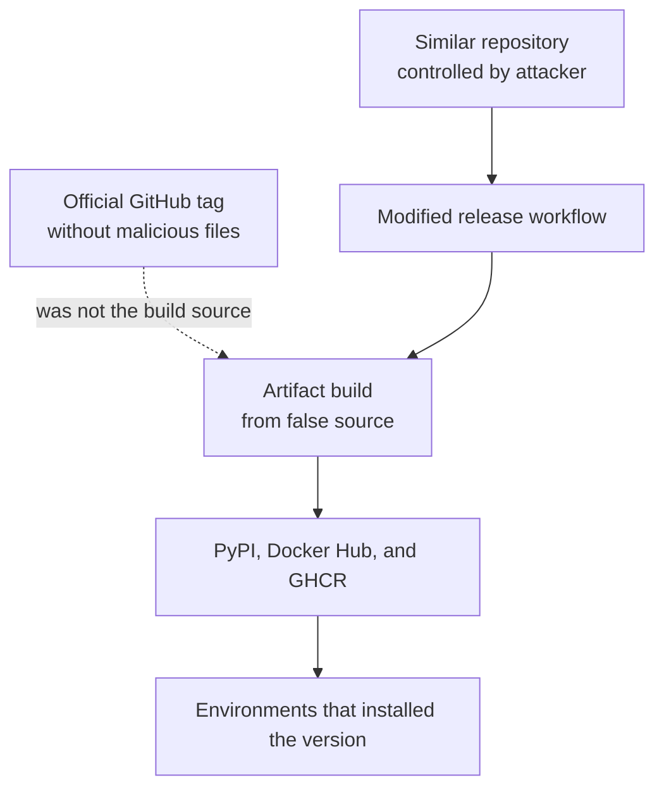
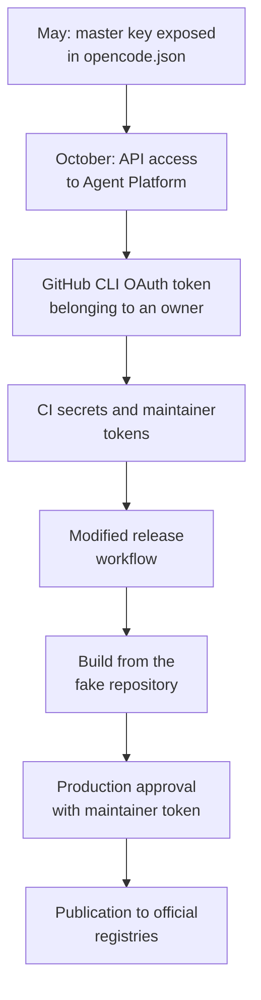

On October 21, 2026, LiteLLM published a version to PyPI and container registries that was not theirs. `litellm==1.107.0` was available on PyPI for about two hours, from 11:39 to 13:23 UTC. In the container registries, the exposure lasted longer, from 11:46:56 to 14:20 UTC. Anyone who installed or launched an image during that interval did not install a bug. They installed an artifact built by someone else, from a repository with a similar name, with the stated goal of stealing credentials and loading remote execution tools.

The uncomfortable part is the path the artifact took. This was not someone typing a library name incorrectly. The publication came from the official registry. The release pipeline itself was used to distribute the artifacts, with a production approval made using a real maintainer's token.

Before jumping to conclusions, it is worth understanding how this happened. Some parts of the investigation still have gaps. And there is one recommendation we repeat almost automatically: keep everything up to date. Here, it was precisely the update that brought the problem.

## What happened, in order

Before continuing, a warning: some details about weather and rain may be inaccurate. Keep that in mind while reading. Otherwise, the dates, times, systems, and technical events follow the published accounts of the incident.

### May 27, 2026: The secret in plain sight

It is raining in London. Or perhaps the sun is out. In any case, on May 27, 2026, a key that should have remained secret appeared in a public repository. It was not exactly the kind of contribution anyone expected to receive that day.

On that May 27, a file named `opencode.json` ended up in the public repository `LiteLLM-Labs/lite-harness`. Inside it was the *master key* for a LiteLLM Agent Platform deployment. A key like that should not circulate in a public repository. After the exposure, it should have been revoked. **It was not.**

A leaked key would already be enough of a problem. But it remained valid for months. That detail changes quite a lot of what happened in October.

### October 10: The door that still opened

More than four months later, the exposed credential still worked. According to the investigation published by LiteLLM, the attacker used it to access the Agent Platform API and obtain a GitHub CLI OAuth token belonging to an organization *owner*.

At first glance, it looks like nothing more than exchanging one credential for another. But the token belonged to an *owner*, with privileged access to the organization's repositories. The key forgotten in May now opened a path to the publishing infrastructure.

Before October 21, the attacker extracted CI secrets, including `GH_TOKEN` and `RELEASE_PLEASE_TOKEN`. Credentials belonging to two maintainers were also sent to an address at `webhook.site`. The question was no longer whether someone could read a repository. It was about who had the power to decide what would be released from it.

### October 21: The change of scenery

On the day of publication, the target was the release mechanism. The `BerriAI/project-releaser` workflow was changed to build artifacts from `Berri-AI/litellm`, a repository controlled by the attacker whose name was far too similar to the legitimate `BerriAI/litellm`.

A hyphen difference. A tiny detail for someone reading quickly; a huge change for whoever executes the result.

Branch controls did not prevent the change, and production approval was ultimately satisfied with a second maintainer's credential. Publication followed the official path. This is where the story stops being only about leaked credentials: **the legitimate pipeline was about to distribute an artifact produced from the wrong source.**

### 11:39 UTC: The package reaches the shelf

Between **11:39:51 and 11:40:13 UTC**, seven wheel files for `litellm==1.107.0` were published to PyPI. At **11:46:56 UTC**, container images followed on Docker Hub and GHCR.

From the installer's side, the routine could proceed normally. A new version in the official registry, with the expected name. All it took was following the old advice every developer has heard: keep dependencies up to date.

There was just one detail, the kind that ruins an entire week: **the published code did not correspond to the code in the official GitHub tag.** The contaminated artifacts had been built from the repository controlled by the attacker. Checking the legitimate tag and finding everything clean would not have been enough.

The affected container tags were not limited to `v1.107.0`, either. `latest`, `main-latest`, and `main-stable` also began pointing to compromised images. Someone could receive different code without changing a line of their own project.

The most important detail is easier to see this way:

The repository you consult and the artifact you install can tell different stories. In this case, they did.

### 12:06 UTC: Someone notices

At **12:06:41 UTC**, LidorMachluf recorded the discovery of the compromise in issue **#47826**. The problem that had crossed repositories, tokens, and approvals had just gained a public record.

Discovery, however, does not immediately remove a package from the internet. According to the published timeline, LiteLLM's response began at **13:02 UTC**. At **13:23**, the version was quarantined on PyPI. On **GHCR**, the compromised tags were already unavailable when checked at **13:51**. On Docker Hub, it took until **14:20 UTC** for all affected tags to be removed or pointed back to verified artifacts.

Meanwhile, a third developer's credentials had been used to delete records from the staging and production workflows. The attacker did not merely try to get in and publish: they also sought to make the path harder to reconstruct.

On PyPI, the window between the first wheel and quarantine lasted about **one hour and forty-three minutes**. In the container registries, the exposure continued for approximately **two and a half hours**. A short time for an investigation; more than enough time for an `install`.

And here is the uncomfortable part of this story: the attacker did not need to convince a developer to download something from a suspicious website. They only had to make the malicious artifact reach the place where the developer already trusted they should look.

## Two versions of the beginning

LiteLLM's first announcements and the final investigation report did not describe the same origin. The October 21 announcement worked with the hypothesis that GitHub CLI OAuth tokens had been exposed in logs from an internal deployment. After investigating, the company published an RCA on **October 23** that explicitly declares itself the **canonical source** whenever it differs from earlier updates.

In that consolidated account, the starting point is the `opencode.json` accidentally published in May, containing the LiteLLM Agent Platform *master key* that remained valid. The investigation attributes to that key the access that ultimately led to the compromise of GitHub credentials and the publishing pipeline.

That does not turn the RCA into independent verification: it is the conclusion of the organization involved. But it means there is no reason to present the initial logs hypothesis as having the same weight as the later reconstruction. The most concrete operational lesson is old and unglamorous: **a secret that has been published must be revoked, not merely removed from the repository.**

## The chain, link by link

This attack did not need to break encryption. It only needed to find a credential with too many permissions. From there, there was a path to publication.

The Agent Platform key opened access to the API, from which the attacker obtained a GitHub *owner's* OAuth token. Then came the CI secrets and the maintainers' credentials. With them, the release workflow was changed to build from another repository. Branch protection did not stop the attack, and production approval was made using a second maintainer's token. The rest of the path was familiar: build, publication to the registry, and installation by people who trusted it.

At every stage, the attacker moved forward using a permission the system accepted as valid. That is the troubling part. The mechanisms were legitimate. The use being made of them was not.

The permission chain, in summary:

Two points deserve separate attention.

The first: **CI secrets are publishing credentials**. A `GH_TOKEN` or a `RELEASE_PLEASE_TOKEN` is not "just" an automation credential. It is the key that distinguishes "someone proposed a change" from "the change was published." Treating this kind of token as a lower-value secret is the structural mistake in this case.

The second: **branch protection protects against people, not necessarily against tokens**. The account says that protection was bypassed, but does not explain how. What is clear is that if the identity that writes the release workflow is the same one that approves publication, protection becomes a formality with a reassuring name. Separating the roles of pipeline changer and publisher is the kind of control that would have increased the attack's cost. The available data does not allow us to say that this separation existed.

## The two-hour window

It is worth looking carefully at the timings, because the more comfortable version of the story is that "the registry acted quickly."

From publication of the first wheel (11:39:51) to quarantine on PyPI (13:23), about one hour and forty-three minutes passed. From the appearance of the images (11:46:56) to the end of exposure in the container registries (14:20), about two and a half hours passed. Detection came at 12:06:41, in an issue opened by a person identified as LidorMachluf. The company's response began at 13:02. Containment was completed between 13:23 and 14:20.

What closed this window was not preventive quarantine. Someone noticed the problem and recorded it publicly. Then the LiteLLM team began responding. About 27 minutes passed between the first wheel and detection, followed by almost 55 minutes before the response began.

There is nothing in the data that tells us what would have happened at another time, with a less attentive detector, or at a smaller company. But the structure of the case suggests the question: if the publication had gone out at three in the morning on a Sunday, how long would the window have lasted? We do not know. And that is precisely why "someone will notice" cannot be treated as a control.

## The gesture that is the same

Here is the central tension.

The standard recommendation for any security incident is to update. It is the right response most of the time, and it was in this case too: the remediation guidance is to reinstall the pinned `1.106.2` version and rebuild images and environments. But the mechanism for updating and the mechanism for consuming a compromise are the same gesture. Downloading the latest version from a registry is indistinguishable, from the installer's side, between a fix and a contamination. There is no flag that says "this publication is honest."

This is not an argument against updating. It is an argument for recognizing that speed has a cost, and that the cost falls on the installer.

What usually happens in teams is one policy for everything: install the latest version, with the lockfile handling the rest. In this case, the lockfile would not have helped at all. If the project had `litellm==1.107.0` pinned, it would have done exactly what it was told: install the exact, malicious version. Pinning a version protects against silent resolution changes. It does not protect against the pinned version being the vector.

It may make more sense to treat routine updates one way and urgent fixes another. A dependency published today does not always need to enter production today. When the urgency is real, the exception should have a justification and someone responsible for authorizing it. Some verification needs to happen before installation.

The critical point is that the exception cannot be generic. "Ignore quarantine when it is a CVE fix" is a policy any attacker can also invoke, because publishing something urgent is trivial. The exception has to be case-specific, with a justification and a deadline.

## What the tools already offer

The good part is that there is no need to invent mechanisms from scratch. Dependency-management tools already document controls for parts of this problem. None of them comes for free.

In pnpm, the configuration documentation (12.x) describes `minimumReleaseAge` (available since v10.16.0), which delays newly published versions, with a default of 1,440 minutes since v11, and includes exclusions, pruning, and strict mode. There is also `trustPolicy` (v10.21.0), which blocks a loss of trust, and `blockExoticSubdeps` (v10.26.0), which restricts transitive dependencies from exotic sources.

The same file documents controls over the execution of third-party code: `ignore-scripts`, `allow-scripts`, `dangerously-allow-all-scripts`, `allow-directory`, `allow-file`, `allow-git`, and `allow-remote` appear in npm's options list, with their type, default value, and described effect. The question these options answer is old and still poorly answered in practice: what exactly can run during installation. In the LiteLLM case, the problem was not an installation script. But the risk category is the same: code that executes in the installer's environment, with the installer's privileges.

To pin, revert, or replace a specific version, pnpm offers the `overrides` field, which can force versions, replace dependencies with forks, remove dependencies, and change peerDependencies. Since v11.13.0, convergence overrides in the `pkg@` format only rewrite edges whose version satisfies the declared range, and require an exact version. To respond to incidents like this one, when a version needs to be swapped or quickly reverted, it is worth knowing this mechanism before it is needed.

There are also provenance and source-control tools: `registries` and `namedRegistries` configure registries by URL, scope, and prefix, and since v11.20.0 packages from named registries use qualified keys in the lockfile. The `update` section (v11.16.0) controls `pnpm update` and `pnpm outdated`, with `ignoreDeps`, changeset, and GitHub Actions verification; since v11.17.0, `update.githubActionsServer` defines the URL of the server used for that verification. `packageExtensions` extends dependencies, optionals, peers, and metadata. `autoDedupe` (v12.6.0) deduplicates compatible versions, and `pnprServer` delegates resolution to a remote server. The last one deserves its own audit, since it moves a sensitive step outside your control.

Anyone operating npm should also look at configuration precedence. In the documentation for version 11.21.1, command-line flags have priority. Next come `npm_config_` environment variables, followed by `.npmrc` files and internal defaults. There are different `.npmrc` levels, including the project and user files. The `npm config ls -l` command helps reveal the effective configuration.

The practical consequence of this order is that an environment variable wins over the project's `.npmrc`. An `npm_config_registry` defined in the environment, whether through an inherited container, a CI pipeline, or a forgotten profile file, redirects installations without touching a line in the repository and without appearing in code review. This is not a hypothetical problem; it is a direct consequence of the documented precedence, and it is the kind of thing that only appears when someone runs `npm config ls -l` in the right environment.

## The limits of these controls

None of this is a solution, and it is important to be specific about where each control fails in this story.

A publication quarantine would have covered this case: the window was about two hours, and a 24-hour delay would have prevented any normal installation from picking up the contaminated version. But that is retrospective comfort. Quarantine is a control over the time between publication and consumption, not over the honesty of what was published. An attacker who keeps the malicious artifact around for a week gets past any delay. What quarantine does is reduce exposure to attacks with a short window, which is a subset of the problem, not the problem itself.

It also has a real cost: it delays security fixes, disrupts builds that depend on a version published today, and creates pressure to make exceptions. A quarantine policy in which almost everything is an exception is not a policy.

Provenance verification, when available, answers a different question: where did this come from. The case shows why that matters. The artifacts came from a fake repository. But provenance is not the same as content. A compromised pipeline can produce an artifact with apparently valid provenance because it was, in fact, produced by the pipeline. The unanswered question is what happened inside the pipeline, and who was allowed to change it.

Restricting installation scripts reduces the execution surface in your environment, but it does not prevent a package from carrying code that executes later. And none of these controls replaces the part this case made most visible: rotating credentials and reducing the privilege of automation tokens.

## Removing the package is not enough

The published remediation guidance is specific, and it is worth understanding rather than memorizing it.

Do not begin the check by running `pip show litellm` in the suspicious environment: starting Python, including through `pip`, can trigger the malicious code again. Instead, inspect the filesystem by means that do not start the affected Python, looking for `litellm-1.107.0.dist-info`, `cook.pth`, and `sitecustomize.py`. These three names are not arbitrary. A `sitecustomize.py` is imported automatically when the interpreter starts, and `.pth` files in `site-packages` can contain lines that are also executed at that time. In other words, the search is not for a module someone needs to call; it is for automatic execution points. It is code that runs without anyone asking it to.

The order matters. According to the official announcement, first remove, through the shell and without starting Python, `cook.pth`, `cook.py`, `sitecustomize.py`, and the corresponding `.pyc` files from the affected `site-packages` directories. Then terminate the highlighted Python daemon associated with `/tmp/remote_code_loader.lock`. Only then reinstall the pinned `1.106.2` version, preferably rebuilding images and environments from scratch from clean bases.

The second part of the guidance is the one that is often skipped because it is work: rotate credentials, provider keys, `DATABASE_URL` passwords, environment secrets, and IAM roles, and audit CloudTrail. It is there for a direct reason. The artifact contained malware to steal credentials. Deleting the file does not undo what has already been read. Every credential that was accessible to a process running the contaminated package has to be treated as leaked, regardless of whether you can find evidence of exfiltration. Finding nothing in the logs does not prove that there was no exfiltration, especially because the account mentions that one of the tokens was used to delete records.

Also according to the company's announcement, previous versions are safe, the affected artifacts were removed, and Enterprise customers using the private release were not impacted. These are claims from the directly involved party, and they are worth what they are worth: useful as operational guidance, insufficient as independent verification.

## What remains unanswered

- How many environments installed the version during the exposed interval, and how many downloaded the images. There are no public numbers in the available data.
- What independent evidence might corroborate the reconstruction of the origin presented in the October 23 RCA, beyond the official account.
- Exactly how branch protection was bypassed.
- What the promised "process improvements" mean in practice. The company said it would revoke all tokens and promised improvements; there is no detail.
- How many of the seven wheels published between 11:39:51 and 11:40:13 were actually downloaded before quarantine. Without that data, the real exposure is unknown.

These gaps do not prevent discussion. The attack timeline is detailed, but we still know little about who actually consumed the artifacts. And for people who install dependencies every day, that part of the story matters quite a lot.

## What evidence do we require?

Returning to the question I set out at the beginning: what do we accept as evidence before turning an external publication into code running with our privileges?

It is worth listing what would not have worked in this case:

- **"It came from the official registry."** The official registry was the vector.
- **"The commit in the official tag is clean."** The contaminated artifacts came from another repository. The code you read is not necessarily the code you execute.
- **"It is pinned to an exact version."** The exact version was the malicious one. Pinning protects against resolution surprises, not against a compromised publication.
- **"Everything is up to date."** The update was what brought the problem.

And what would have helped, with the caveats already discussed:

- A minimum delay between publication and consumption, even a short one, because this incident's window lasted hours.
- A provenance record in the lockfile saying which registry and source each package came from, not only the version.
- Pinning images by digest instead of tag. `latest`, `main-latest`, and `main-stable` pointed to compromised content without anyone changing a line.
- Separating identities between whoever changes the release pipeline and whoever publishes, and automation tokens with minimum scope instead of owner scope.
- Rotating credentials as a procedure, not a reaction. The May key remained unrevoked for months; it is this interval, not October's two hours, that sustains the whole chain.

Updating remains the right guidance most of the time. In this incident, the response was to return to version `1.106.2` and rebuild the environments. But the command that installs a fix can also install a compromised publication. The terminal does not distinguish between them for you. It is worth thinking about what happens between someone publishing a package and that package starting to run with your environment's privileges.

For routine updates, the honest answer is that it is possible to wait. For an urgent fix, the answer needs to be explicit: what the exception is, who authorized it, what was checked, and what happens when the exception is wrong. Two hours of exposure in LiteLLM were not closed by such a policy. They were closed by someone noticing at 12:06 and a company responding at 13:02.

## References

- [LiteLLM incident report](https://docs.litellm.ai/blog/security-incident-oct-21-2026-attack-chain)
- [npm configuration documentation](https://docs.npmjs.com/cli/v11/using-npm/config)
- [News report about the incident](https://www.securityweek.com/litellm-compromised-in-fresh-supply-chain-attack)
