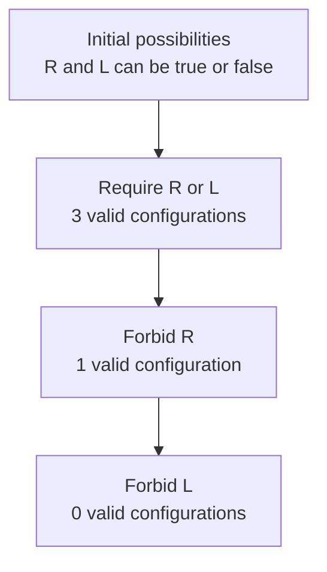
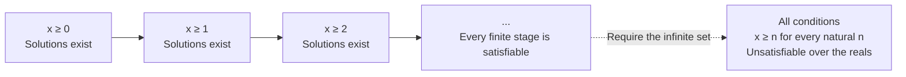
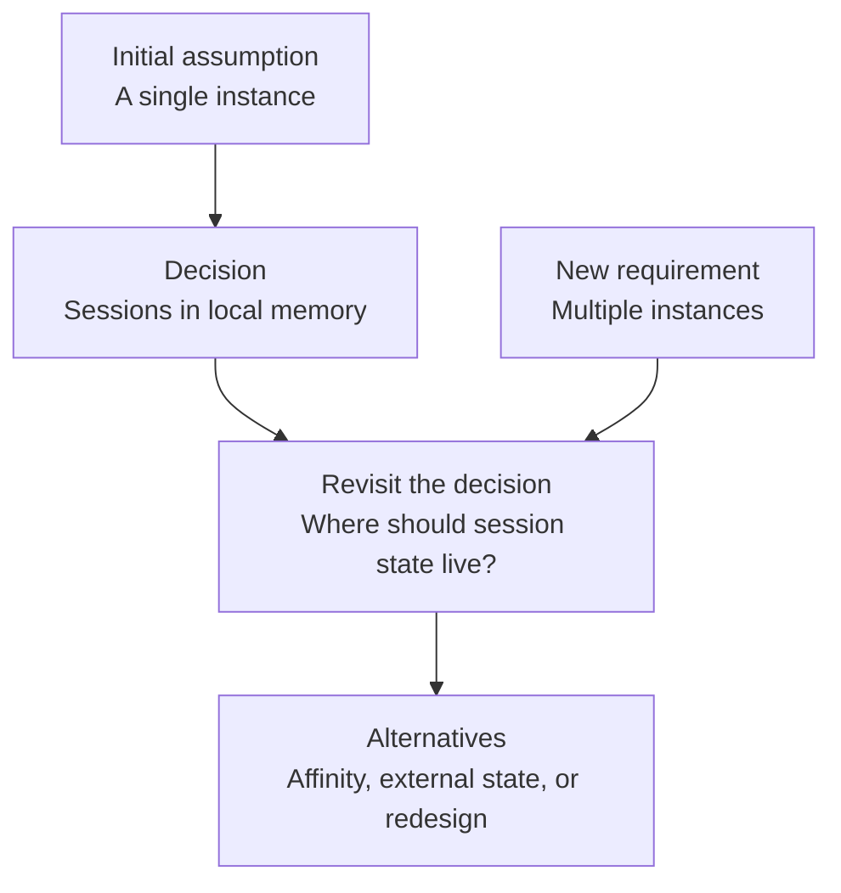

Imagine I ask you to do something fairly simple: look right or left. You don't have to do both, just pick a side. So far, hardly a major cognitive challenge, I hope. Now I add a rule: you're not allowed to look right. Fine, look left. But I decide to make the game a little more interesting. You're not allowed to look left either. Congratulations, we've managed to make a task impossible without writing a single line of code.

What interests me isn't exactly *why* you can't follow all three rules. That part seems obvious. I want to understand **at what point a set of constraints stops admitting a solution**, and how much that idea can tell us about the decisions we make when building software. Maybe there's a more interesting way to look at a system's architecture than simply listing its features. What if we started with the possibilities our own decisions eliminate?

## When a rule stops being just a rule

Let's give our two possibilities names:

- `R`: look right.
- `L`: look left.

The first condition requires looking in at least one direction. We write `R ∨ L`. The `∨` symbol means logical **OR**, which also allows both directions at once. The second rule forbids looking right: `¬R`. The third forbids looking left: `¬L`. Put them together and we get:

```text
(R ∨ L) ∧ ¬R ∧ ¬L
```

The `∧` symbol means logical **AND**. We want every condition to hold at the same time, and there's no assignment of truth values to `R` and `L` that makes this expression true. Before the final rule, there was still a way out: `R = false` and `L = true`. After it, there isn't.



This is an example of **unsatisfiability**. In logic, a formula is satisfiable if there's at least one assignment of values that makes it true. If no assignment works, it's unsatisfiable. These questions appear in **SAT** (*Boolean Satisfiability Problem*) and in **CSP** (*Constraint Satisfaction Problems*), a broader family of problems in which variables must take values while respecting a set of conditions.

One distinction is worth making before we continue: I'm talking about constraint satisfaction in logic and computing, not the *Theory of Constraints* from operations management, which focuses on identifying bottlenecks. The names sound similar, but the questions we're asking here are different.

## A set doesn't get bigger just because you repeat yourself

If we have a set `C = {A, B}` and add `A` again, we still have `{A, B}`. Repeating an element doesn't create a new one. But when constraints are logical expressions, there's a subtlety: two different sentences can impose exactly the same condition. "Looking right is forbidden" and "You must not look right" are different phrasings, but logically equivalent.

There's a more interesting case. Suppose we have these rules:

> Looking right is forbidden.

And then:

> Looking right is forbidden when it's raining.

The second condition, on its own, isn't equivalent to the first. But if looking right is already forbidden in every situation, the rain changes nothing. The new rule doesn't eliminate a single additional possibility. That's why **counting documents, sentences, or requirements isn't the same as counting constraints that actually shrink the solution space**.

A specification could contain 500 rules and still allow exactly the same configurations as another with 20. The number alone tells us very little about what the system can or cannot do. To make this more precise, let's call the universe of possible configurations `Ω` (omega), and let `S(C)` be the subset of configurations that satisfy every constraint in `C`.

When we add a condition `c`, we get:

`S(C ∪ {c}) ⊆ S(C)`

In other words, **adding a constraint cannot increase the set of valid solutions**. That set can stay the same, shrink, or become empty. If the new rule doesn't change `S(C)`, it's redundant relative to the current set, even if it isn't a word-for-word copy of an existing rule. And here's the interesting bit: *redundancy isn't something we can always determine by comparing two rules in isolation*. One condition can follow from several others combined.

## So is there a limit?

It depends on the universe we're considering. I know, "it depends" is probably software engineering's most popular answer. But this time we can be more specific. Imagine a system with exactly 100 possible configurations. Every constraint that genuinely reduces the solution space eliminates at least one configuration.

We might go from 100 to 70, from 70 to 12, and from 12 to one. At that last step, the system is **fully determined within that model**: there's only one acceptable configuration left. It's still satisfiable. Add another condition that eliminates that final configuration, and we're down to zero. Now it's unsatisfiable.

In a finite universe of `N` configurations, a sequence in which **every new constraint strictly reduces** the solution set can have at most `N` reductions before reaching the empty set. If we want to retain at least one solution, there can be at most `N - 1` such reductions. This doesn't mean there's a limit of `N` documents, requirements, or expressions that someone can write. We can keep adding conditions that don't change the solutions. The bound applies to effective reductions of the solution space, under those assumptions.

Now replace the finite configurations with a real-valued variable `x`. We start with `x ≥ 0`, then require `x ≥ 1`, `x ≥ 2`, `x ≥ 3`, and so on. For any **finite** number of these conditions, we can still find a solution. Just choose a sufficiently large value. But if we require `x ≥ n` for every natural number `n`, all at once, no real number satisfies the entire collection. Every finite stage works. The complete infinite set doesn't.



This isn't some software-specific oddity. It's a mathematical difference between restricting a finite domain and working with an infinite one. And it's a good reason to be skeptical whenever someone claims that "a system can only handle so many constraints."

## When mathematics meets architecture

Now imagine a service that started small, running on a single instance. To save time and effort, user sessions live in the process's memory. There's nothing necessarily wrong with that. Given the original context, it may have been a perfectly reasonable choice. But the product grows, and a new requirement appears: we need several instances handling requests from the same users.

The feature might sound simple on a ticket: "enable horizontal scaling." Just add more replicas, right? Well, maybe not. If a user's session lives in instance A's memory, what happens when the next request reaches instance B? We could use session affinity, move state to an external store, or redesign the behavior. Each option comes with its own costs, guarantees, and limitations.

Notice that the new requirement doesn't necessarily mean throwing the whole system away. But it does force us to revisit earlier assumptions. The decision about where sessions live wasn't made in a vacuum.



But there's a catch in this analogy. In mathematics, a specification can be unsatisfiable because no possible solution respects every constraint. In engineering, an architecture that's **already implemented** might simply fail to meet a new requirement even though another architecture could. Those are different situations.

We also can't claim that every trade-off creates a contradiction. Keeping sessions in local memory can reduce initial cost and complexity while making certain distribution strategies harder. That's a decision with consequences. It becomes a logical incompatibility only if we formulate conditions that genuinely cannot coexist within the model we're considering.

There's another detail: satisfiability doesn't tell us how expensive it is to find or implement a solution. A set of requirements can be satisfiable and still demand an economically absurd change, or a computationally difficult search. Logic tells us whether a solution exists **within the model**. It doesn't automatically give us an effort estimate, an architecture diagram, or an approved budget.

## Maybe the problem isn't the next feature

Let's go back to our service with in-memory sessions. If someone asks for an endpoint to expose information we already have, maybe all we need is a route, some validation, and tests. If they ask for authentication shared across instances, we might be looking at something much less innocent. The difference isn't necessarily the size of the request or the number of lines of code. It's in the **earlier decisions the new feature has to live with**.

Over time, systems accumulate choices that made sense in a particular context. And those choices start influencing others. A storage decision affects processing; a processing decision may affect consistency; a consistency decision changes what we can promise to API consumers. I'm not suggesting that every aging architecture inevitably becomes unsatisfiable, or that there's a magic formula for the ideal number of constraints.

The question is slightly different: **when we add a feature, are we merely narrowing the solution space, or do we need to revisit the conditions that defined that space in the first place?** The former may be a relatively straightforward extension. The latter might explain why some apparently trivial features end up demanding weeks of discussion, refactoring, and decisions nobody remembers making.

## And what do we do with all those decisions?

I don't have a definitive answer yet. It would be rather funny to start an article about satisfiability by inventing a universal solution to a problem we've barely defined. But there's a question worth taking forward: if earlier decisions establish constraints, **how do we identify when a new requirement makes it necessary to revisit them?**

Counting recorded decisions isn't enough. A single condition can clash with something important; thousands of redundant conditions might change absolutely nothing. Maybe what we should track isn't just the volume of decisions, but the relationships between them, the assumptions supporting them, and the possibilities that disappear as the software evolves.

That brings us to another problem, one that's closer to everyday engineering and particularly uncomfortable when we start producing specifications faster than we can review them. But that's a conversation for the next article. For now, I want to keep one distinction in mind: **a system with exactly one possible solution still works within its rules. A system with no possible solution needs to change its rules, its domain, or its expectations.** And perhaps some of the most expensive architecture discussions begin when we notice that difference too late.

---

## References for further reading

- [Z3 Guide: Propositional Logic](https://microsoft.github.io/z3guide/docs/logic/propositional-logic/). An introduction to satisfiability in propositional logic and the relationship between validity and satisfiability.
- [Z3 Guide: Introduction](https://microsoft.github.io/z3guide/programming/Z3%20Python/Introduction/). Examples of how a solver checks sets of constraints.
- [Harvard CS50 AI: Constraint Satisfaction](https://cs50.harvard.edu/extension/ai/2020/fall/notes/3/). Course notes explaining variables, domains, and constraints through practical examples.
